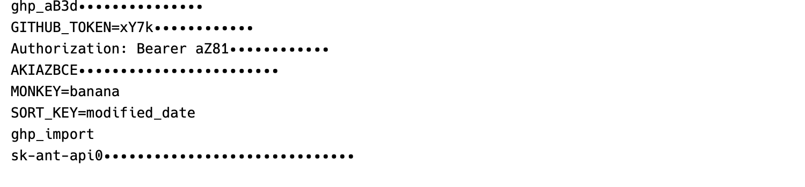

# Hack Masked

Hack 3.003 with the secret-masking rules from Obel Mono Masked 1.000.



Hack Masked replaces a detected secret with dots after the first four visible
characters. `GITHUB_TOKEN=xY7kQ2pLm9ZtR4vB` shows as `GITHUB_TOKEN=xY7k` plus
twelve dots. The text does not change. Copy and paste returns the real key.

## Install

Download the four TTFs from `dist/` or the latest release. On macOS,
double-click each file. From a clone, run `./install.sh`.

The family includes all four Hack styles.

## Turn it on

Pick `Hack Masked` as the font in the app. There is no separate switch. The
rules live in the font's `ccmp` feature and run when the app shapes text.

| App | Setting |
| --- | --- |
| Terminal.app | Settings → Profiles → Text → Font → Change → `Hack Masked` |
| iTerm2 | Settings → Profiles → Text → Font → `Hack Masked`, then enable **Use ligatures** |
| VS Code | `"editor.fontFamily": "Hack Masked"` and `"editor.fontLigatures": true` |
| Zed | `"buffer_font_family": "Hack Masked"` |
| Ghostty | `font-family = "Hack Masked"` |
| Kitty | `font_family Hack Masked` |
| WezTerm | `font = wezterm.font("Hack Masked")` |
| Windows Terminal | Settings → Profiles → Appearance → Font face → `Hack Masked` |

Restart the app if `Hack Masked` does not show in the font menu.

To check it, run the command below.

```sh
printf 'GITHUB_TOKEN=xY7kQ2pLm9ZtR4vB\n'
```

You should see `GITHUB_TOKEN=xY7k` and then dots.

## What it does not do

The mask changes pixels only. Copy and paste still returns the real key. So
does shell history, and so does any process that reads the text. Apps that do
not shape text, like Alacritty, show the plain string. A key that wraps to a
second line shows on that line.

## How it works

Obel Mono Masked keeps the rules in the OpenType `ccmp` feature.
`build_masked.py` copies that rule set into Hack, maps the glyph names through
Unicode, adds invisible note glyphs that copy Hack's own outlines, and adds the
mask dots. `compare.py` shapes 520 strings in both fonts and checks that the
output matches. `preview.png` was rendered with CoreText.

## Build

```sh
./build.sh
./install.sh
```

Nix supplies the build toolchain. The flake pins fontTools and HarfBuzz. The
`Hack/ttf` and `Obel/ttf` folders hold the input fonts.

## Credit

The rules and the mask dot are from [Obel Mono](https://typographic.systems/obel-mono/)
by Cody Collier and the Obel Mono Project Authors. Read the original post,
[A typeface that keeps a secret](https://typographic.systems/journal/a-typeface-that-keeps-a-secret).

Hack is from Source Foundry: https://github.com/source-foundry/Hack.

## License

The fonts are SIL OFL 1.1 because they carry the Obel material. The Hack parts
stay MIT and Bitstream Vera. Build scripts are MIT. See `LICENSE`,
`Hack-LICENSE.md`, and `Obel-OFL.txt`.

This is an unofficial modification. It is not affiliated with or endorsed by
Source Foundry or the Obel Mono Project.
